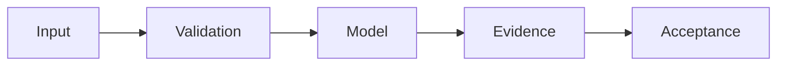

# Real Estate Lead OS — SCIENTIFIC DOSSIER V5

**Дата:** 24.10.2026. **Статус:** OFFLINE CANDIDATE.

> Научно-технический source audit. Наличие кода, документации, тестов или workflow не означает фактического запуска, подтверждённой доходности или production readiness.

## Проблема и метод

SQLite/FTS5, консервативное ранжирование и операторская верификация лидов.

## Проверенные исходники

- [lead_os/core.py](../lead_os/core.py)
- [tests/test_lead_os.py](../tests/test_lead_os.py)

## Формализация и проверка

Общее требование: отчёты должны связывать claim с commit SHA, данными, тестовыми параметрами и наблюдаемым raw output. 

**Acceptance:** Precision@20 на независимо размеченном наборе, false-positive rate, lawful basis, запрет unattended outreach.

## Ограничения и отрицательные результаты

Высокий heuristic score не означает согласия на связь и подтверждённой покупки.

## Дальнейший инженерный план

1. Проверить версии зависимостей и воспроизводимость команд тестирования.
2. Добавить negative/adversarial controls, документировать failed-case.
3. Зафиксировать фактический CI verdict и привязанный SHA; не повышать зрелость из одного факта существования workflow.
4. Поддерживать границу между R&D, CANDIDATE и DEPLOYED.

Оформление по научному профилю [dlp_solver](https://github.com/Shtenco/dlp_solver) и [synergy_system](https://github.com/Shtenco/synergy_system). Исходный README сохранён.
